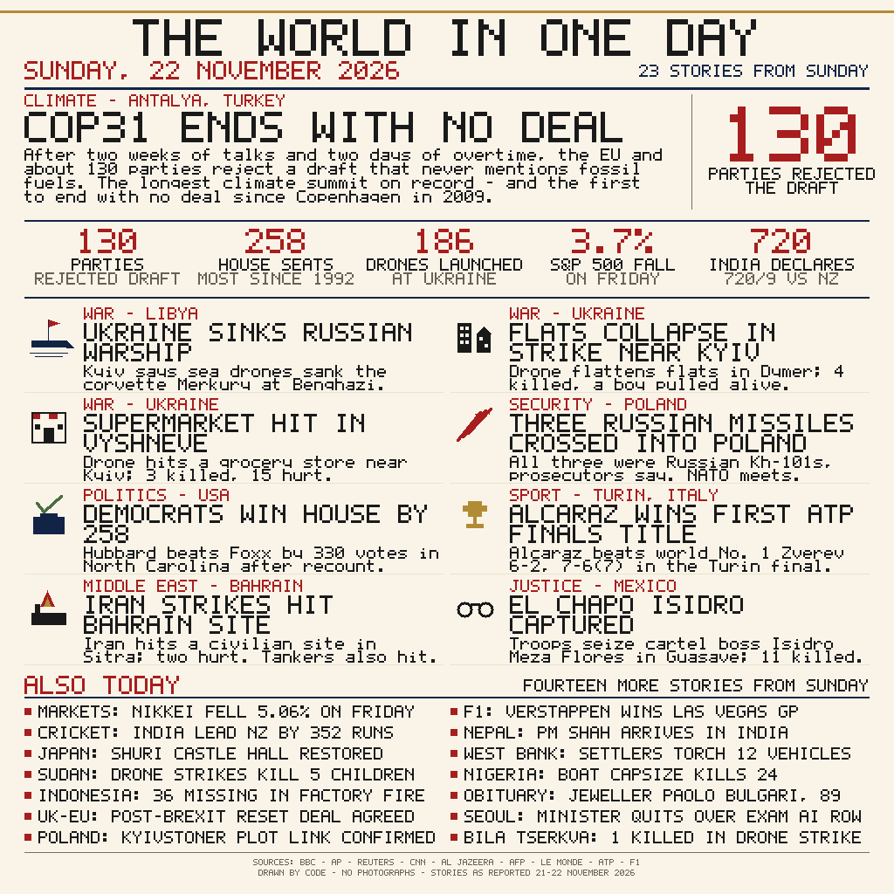

# news-image-20261122-v5

[](https://make.fun/bounty/news-image-20261122?utm_source=github&utm_medium=readme&utm_campaign=news-image-20261122)
[](https://make.fun/bounty/news-image-20261122/leaderboard?utm_source=github&utm_medium=readme&utm_campaign=news-image-20261122)
[](https://make.fun/bounty/news-image-20261122?utm_source=github&utm_medium=readme&utm_campaign=news-image-20261122)

The world in one day — a newspaper front page for Sunday, 22 November
2026, drawn entirely in code. A masthead with the date, the COP31
collapse as the lead with a big "130" numeral anchor, a by-the-numbers
strip, eight more stories in a grid with a small drawn pictogram each,
and fourteen further stories under "Also today". Twenty-three real
stories in all, each checked against reporting from 21–22 November 2026
(see SOURCES.md) — including three v4 did not have: the Vyshneve
supermarket strike, the Poland confirmation of the Kyivstoner plot link,
and the overnight 186-drone barrage.



## Run it

```sh
mkdir -p out && MAKEFUN_OUTPUT_DIR=out python3 main.py
```

`main.py` uses only the Python standard library. It writes `entry.png`
(1024×1024, under 1 MiB). Running it twice produces byte-identical
output — no network, no randomness, no wall clock. All text is drawn
with a 5×7 bitmap font defined in `main.py` itself.

---

<sub>Entered on [make.fun](https://make.fun/bounty/news-image-20261122) for the news-image-20261122 bounty.</sub>
